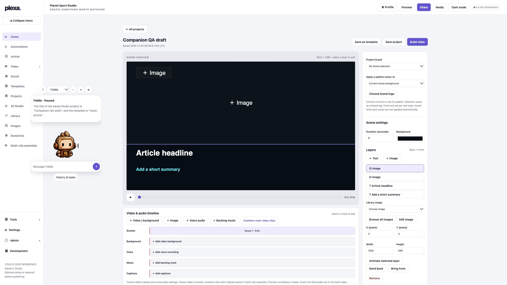
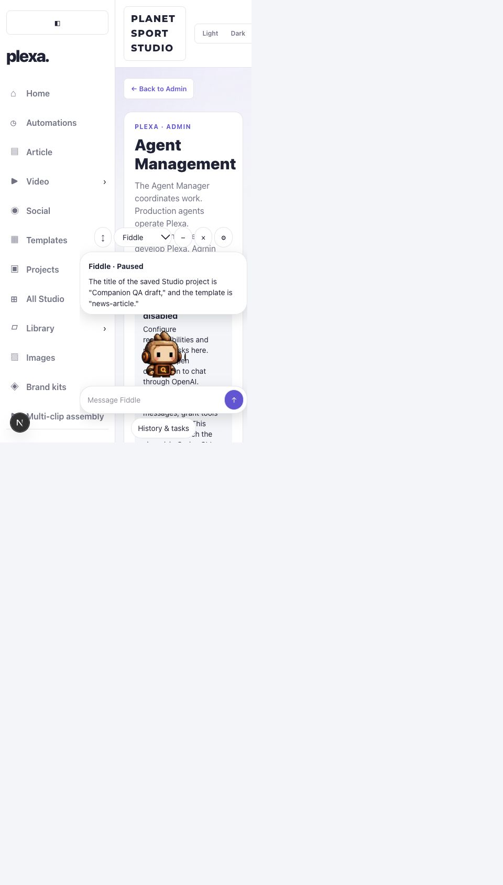

# Floating agent companion — Stage 1 review

2026-11-04 · development branch `codex/floating-agent-companion`. Not deployed. Production activation unchanged.

## Delivered

One shared floating interface in the React shell and hosted Studio: feedback, original character and command bar. Includes selection of eight saved profiles, hover/focus animation, waiting-for-reply animation, static/reduced-motion fallback, keyboard/pointer positioning, hide/restore, minimise, history, scoped tasks, Admin requests and preferences. Resize observation keeps controls within the viewport when images load. Navigation restores the selected companion and position.

The API is an adapter to the existing agent store, character prompt and AI client, not a second conversation database or runner. It accepts only conversation and preference operations. No activation, Codex dispatch, render or publication operation is exposed. Missing OpenAI configuration fails explicitly. Provider failures preserve the saved user message and report failure.

Access uses the existing verified user and exact agent scope policy: Admin all eight, Editors Bob/Fiddle only in explicit assigned brand/workspace; other roles denied. Editor dialogue is restricted to their own attributed messages in that scope; legacy unattributed dialogue is Admin-only. Project IDs are resolved against saved projects server-side. Approved lessons are read from the existing optional learning records; no new learning database or approval writes.

## Evidence

- Full unit suite: 391 passed, 1 existing skipped. Focused final agent/API suite: 33 passed.
- TypeScript, lint and production build passed. Lint retains existing unrelated warnings.
- Two authenticated local OpenAI requests completed and persisted. Fiddle confirmed paused conversation; a second response correctly named the saved `Companion QA draft` project and `news-article` template.
- All eight agents remained Paused, zero tasks created, no video renders or publications.
- All eight original still images loaded in the companion. Animated Fiddle WebP loaded after re-enabling animation and reloading. Existing animation assets were reused without changes.
- UI checks: selection, minimise/restore, hide/restore, preferences save/reload, animation off/on, navigation between Agents and Studio, keyboard repositioning, dark/light readability.
- Narrow browser layout measured 480 × 844 CSS pixels (browser minimum); final companion bounds stayed inside it. Desktop measured 2560 × 1440. This is browser evidence, not native iPhone/Android or tablet device certification.

## Boundaries and remaining release checks

- Current main project records often lack explicit brand/workspace metadata. Admin retains existing workspace-wide access; Editor project context fails closed when scope is absent. No scope is inferred from browser input or permissions granted automatically.
- Exact assigned-Editor behaviour is covered by unit/API tests; an authenticated assigned-Editor UI session still needs acceptance testing against configured workspace records.
- No live worker subscription exists in this main checkout. Task updates refresh on navigation, return to the tab, or manual Refresh; there is no invented progress or polling loop. Background push notifications are not implemented.
- The existing broader learning/worker development is not merged by this UI upgrade. The read-only lesson adapter shows only eligible saved approved records; empty records are reported honestly.
- Chat and task preparation/execution remain separate. Full execution, task approval and workflow management use the existing Admin page and its existing gates.
- Preferences use isolated per-user records in plexa-companion-preferences. Saving display settings never writes roles, credentials, scopes or the authentication store. Reads and writes verify the current active, verified Admin/Editor. Legacy preferences are read as a fallback; no migration is required.
- Mobile browser checking below the tool's 480px minimum and a physical tablet check remain outstanding. No CPU or memory benchmark was collected; implementation avoids polling and hidden animations.

## Desktop feasibility

Stage 1 floats inside Plexa only. A Tauri shell is a reasonable first candidate for Mac, with a transparent window and secure existing login; assess platform webview behaviour and packaging before choosing it over Electron. Windows follows a tested Mac pilot. No native build exists, no always-on-top claim is made, and no filesystem/screen/OS access is granted. Stage 2 and deployment require separate approval.

## Changed areas

- `app/components/AgentCompanion.tsx`, `AppShell.tsx`: shared launcher/loading.
- `public/agents/companion.js`, `.css`: companion UI.
- `app/admin/agents/AgentConversation.tsx`, `AgentManagement.tsx`: open the same companion.
- `app/workspace/[[...path]]/route.ts`: hosted Studio integration.
- `app/api/agents/companion/route.ts`: authenticated adapter; route tests.
- `app/lib/agents/access.ts`, `companion.ts`, companion tests: permissions, projections, context, learning.
- `app/lib/agents/model.ts`: conversation attribution.
- `app/lib/auth/types.ts`: legacy preference fallback and scoped access metadata. `app/lib/agents/companion-preferences.ts`: isolated display preference persistence.

Release recommendation: development implementation available for review; complete the remaining scoped-Editor and small-device acceptance checks before requesting production deployment approval.
