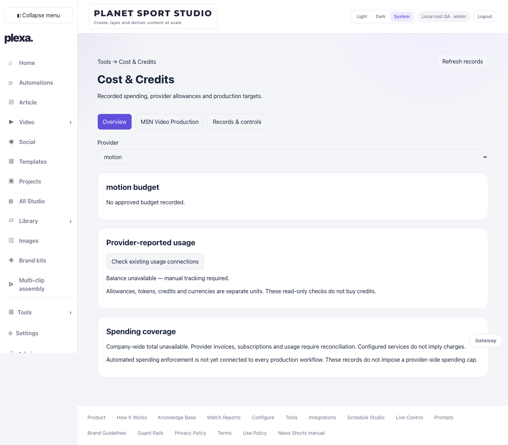
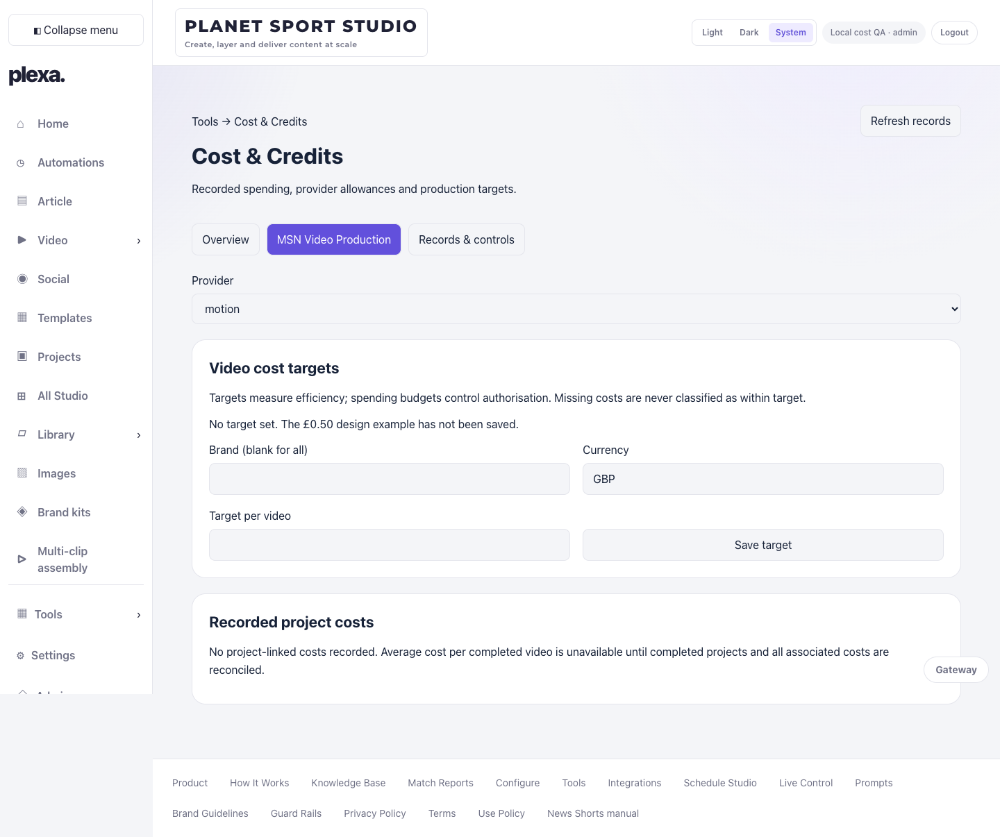
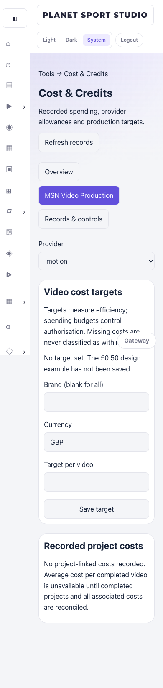

# Cost & Credits — implementation status

## Development branch

`codex/cost-credits`, based on main `8870b67`. Route `/cost-credits`, authenticated Admin data endpoint `/api/costs`, Tools submenu and Plugins link. No production agents or provider settings changed.

## Implemented

- Persistent append-only manual accounting entries, budget revisions and video targets, with authenticated actor and timestamps.
- Existing strong-consistency Netlify Blob storage pattern; conditional writes prevent concurrent updates overwriting financial records. Local saves use a lock and atomic rename.
- API requires an active verified Admin; writes require same-origin requests and version checks. Editor access is denied until workspace-scoped financial visibility is defined.
- Original units retained, manual entries labelled, unknown balances and costs explicitly unavailable. Manual top-ups are records only; no purchase calls exist.
- Shared reservation calculation supports route-independent operation identity, budget dimensions and daily/monthly/all-time periods. Uncertain outcomes retain reserves. Confirmed actual usage releases unused estimates. These functions are not yet wired into production provider submission.
- Direct, allocated and delivery cost calculations remain separate. Recorded project totals are Partial until coverage can be verified. No illustrative target is saved automatically.
- Existing OpenAI/ElevenLabs usage endpoint reused for optional read-only refresh. No new credentials or billing systems.

## Outstanding before full release

- Atomic reservation/settlement store transactions and integration immediately before every chargeable workflow (including API/MCP parity and cancellation/recovery).
- Explicit instruction, reuse-search and approval evidence enforcement, persistent Admin escalations and configured warning thresholds.
- Motion, Cursor, Supabase and Netlify authorised billing collection; provider API eligibility and official endpoint audit. None is represented as connected by this page.
- Provider/invoice reconciliation and linking rather than double counting invoice totals and operation usage.
- VAT, annual billing periods, original credit purchase cost, corrections and currency conversion with documented rates.
- Automated provider charge ingestion remains pending. Video reporting now consumes recorded project-linked charges and settled reservations; historical unpriced operations require reconciliation.
- Admin-approved reusable-asset allocations with shared asset identities and allocation caps.
- Per-provider Cost & Credits tab (currently a Plugins overview link).
- Authenticated production verification and deployment. Local QA is not live evidence.

## Existing main build defects repaired

`app/api/admin/agents/route.ts`: retain narrowed agent ID across the callback and reply command.
`app/admin/agents/AgentManagement.tsx`: escape JSX apostrophe required by lint.

## Verification

- Production build passed after the responsive correction.
- Full suite: 355 passed, 1 skipped (80 test files passed, 1 skipped).
- Authenticated local production-server browser checks: target save returned 200; subsequent GET retained the target; stale version write returned 409; signed-out GET returned 401.
- Desktop (1440px) and mobile (390px) screenshots in `screenshots/`; mobile document has no horizontal overflow. Uses a synthetic local Admin only, not a production login.
- QA target and local authentication fixtures are not production records and are excluded from Git.

## Video-cost integration completed locally

- `/api/costs/videos` reads the existing hosted Studio workspace; no duplicate project registry or render workflow.
- Admin-only **Costs** action on finished `/workspace/video` rows opens the selected project in Cost & Credits.
- Project report includes template snapshot timestamp, saved output duration, every retained project-linked attempt, failures/cancellations, provider breakdowns, direct/allocated/delivery costs, cost per finished minute and targets.
- Filters: brand, template, status, provider, completion date and original accounting unit. CSV export uses the filtered rows and protects formula-leading cells.
- Completed projects counted once across rerenders. Monthly averages use reconciled completed projects only; partial coverage and missing duration are explicit.
- Admin reconciliation requires evidence notes and a server-verified fingerprint of attempts and cost inputs. Subsequent costs, retry attempts or unsettled reservations invalidate completeness. Generic cost endpoint cannot bypass this check.
- Brand-specific targets take priority over the global target. Delivery is excluded from production-target comparisons.
- Financial data remains Admin-only, matching the existing Cost & Credits permission boundary. No production activation, provider generation or deployment occurred.

### Verification for this integration

- Full suite: 365 passed, one skipped. Production build passed.
- Local authenticated browser fixture: failed render + successful render; 0.10 + 0.25 GBP direct costs, 0.20 GBP separate delivery, 0.50 GBP target. Partial before reconciliation, then 0.35 GBP production total and 0.15 GBP below target.
- Video Library Costs action rendered for the Admin. Fixtures are synthetic, isolated and restored after each run; they are not actual billing evidence.
- Screenshots: `screenshots/video-integration-desktop.png`, `screenshots/video-integration-mobile.png`.
- Scope limits: uploaded assets and assembly-only outputs without a Studio project ID are not assigned speculative project costs. Unlinked historical charges, currency conversion, shared asset allocation approvals/caps and automated provider billing ingestion remain separate ledger work. No new render or MP4 playback test was required for this reporting-only change.
- Final production-server browser checks passed at 320, 390, 768 and 1440px with no document overflow. Clicking the Video Library Costs button navigated to the exact project cost report.
