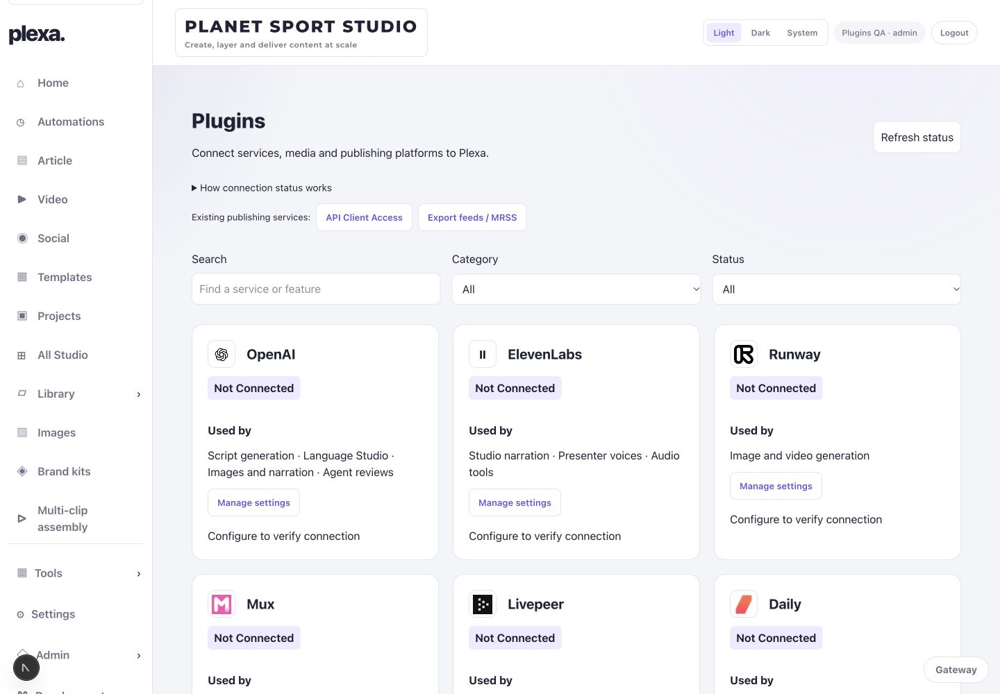
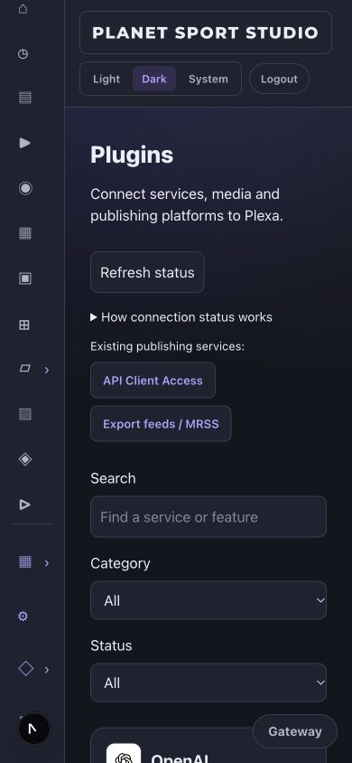
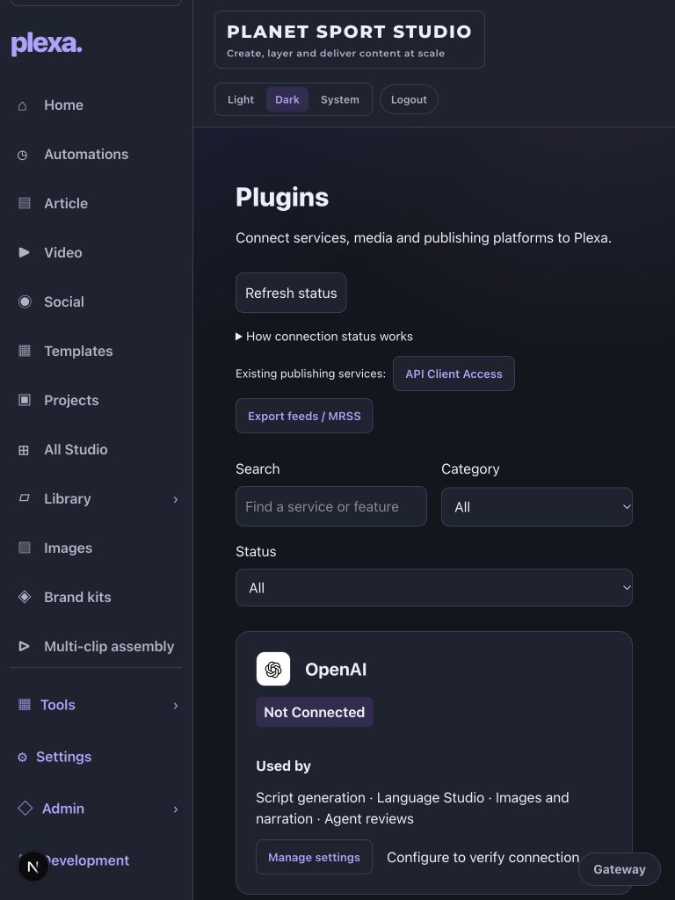
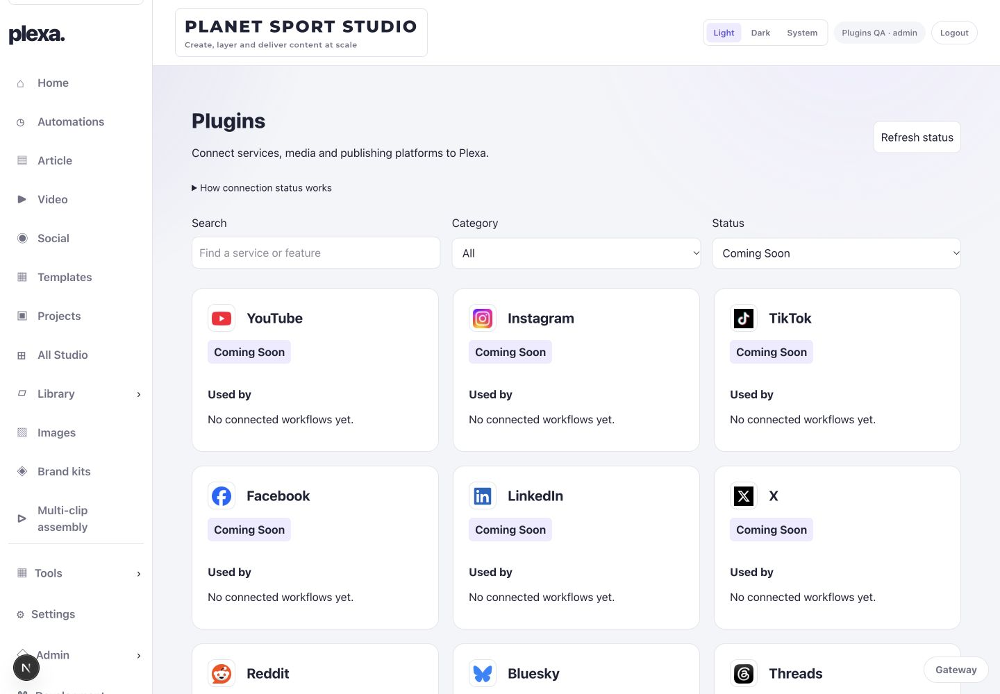

# Plugins Hub — review build, 1 November 2026

## Implemented

Development branch `codex/plugins-hub`, based on production source `922c6fb`. No production deployment, agent activation, automation change, publication or credential migration.

- `/plugins` with Tools → Plugins navigation, search, category and status filters.
- 30 entries: 14 existing provider/runtime integrations and 16 explicitly planned connections. Existing publisher API and export-feed management remain linked separately; they are not falsely represented as third-party OAuth connections.
- Used By identifies existing code-backed workflow dependencies, not invented usage counts or proof that a workflow is currently active.
- Current configuration is read from existing environment/stored Admin settings. No new secrets store, no reconnection, no voice or presenter changes.
- Five evidence-based connection states. Successful checks expire after 24 hours and are invalidated by changed credentials; incomplete multi-part configuration needs attention.
- Eight read-only checks: OpenAI models, ElevenLabs voices, Runway organisation, Mux assets, Livepeer streams, Daily rooms Apify account and DeepSeek models. No generation, rendering, emails or publication.
- Separate non-secret verification records: check date, last success, latency, HTTP status and sanitised error. Hosted conditional leases prevent simultaneous checks; cooldown and timeout bound requests. Network redirects carrying credentials are rejected.
- Admin can check and open existing settings. Editors/viewers can read inventory; other limited roles are denied. Agents receive no new permissions or API credentials.
- 29 official website/brand-pack icons stored locally; Getty uses a labelled initials fallback. Original colours/proportions retained. ICO sources converted losslessly to PNG. Broken artwork falls back to initials. Full provenance is in `public/plugins/provenance.json`.

## Real read-only verification

The existing saved production Admin settings were read in memory for five authorised provider requests. No credentials were saved to this checkout or written to logs. This audit does not copy production credentials into the development page.

| Provider | Actual response | Checked UTC | Scope |
|---|---|---|---|
| OpenAI | HTTP 200 | 2026-11-01 11:50:02 | Models |
| ElevenLabs | HTTP 200 | 2026-11-01 11:50:01 | Voice list only; no TTS |
| Runway | HTTP 200 | 2026-11-01 11:50:01 | Organisation |
| Daily | HTTP 200 | 2026-11-01 11:50:01 | Room list |
| Apify | HTTP 200 | 2026-11-01 11:50:01 | Account |

Machine-readable results: `provider-checks.json`. These are read-only API checks, not proof of paid generation/rendering delivery. Production environment overrides were not copied into local QA. DeepL, Higgsfield and Supabase were present in saved settings but not verified remotely. Mux, Livepeer, Restream and DeepSeek were not present in the saved-settings snapshot; their production environment configuration remains unverified. Resend and Netlify runtime configuration is environment-based. The page evaluates the actual deployment environment when deployed.

## Validation

- Full release gate: TypeScript, lint, **317 passed / 1 existing skipped** unit/API tests, production build.
- 19 focused tests cover credential-bound status, expiry, missing configuration, read-only ElevenLabs checking, sanitisation, lease conflict/recovery, cooldown, role restrictions and same-origin checks.
- Actual local Editor requests: GET inventory 200, `admin:false`, 30 cards; POST provider check 403.
- Authenticated browser: search, status filter (16 planned cards), empty results, Tools submenu destination, Admin management controls and Editor absence of management controls.
- Light/dark visual checks; 320, 390, 768 and 1440px layouts. Tablet header overflow was found and fixed; measured document width equals viewport width at 320, 390 and 768px.
- All displayed icon files loaded successfully. No runtime third-party logo fetches.
- Existing integration routes, secrets setters, generation adapters, feed publishing, agents and automation stores were not edited.

## Screenshots

Screenshots use an isolated local QA account without production provider credentials. Their Not Connected badges are accurate for that development environment, not a report that production OpenAI/ElevenLabs are disconnected.

## Files

- `app/plugins/page.tsx`, `plugins.css`: Hub and responsive presentation.
- `app/api/plugins/route.ts`, `route.test.ts`: authenticated inventory/check API and access tests.
- `app/lib/plugins/catalog.ts`, `service.ts`, associated tests: registry, health observations, safe requests, persistence.
- `features/msn-local/navigation.js`: Tools submenu link only.
- `public/plugins/*`: local provider artwork and provenance.
- `docs/plugins/*`: initial audit, read-only verification results and review evidence.

## Boundaries and remaining work

- Getty artwork could not be retrieved from its official sites; the explicit fallback is used. No unofficial substitute.
- Services without a supported safe check remain Configured — Not Verified. No paid verification is run automatically.
- Coming Soon entries are not working connectors. OAuth, YouTube publishing, Drive, GitHub, Getty and new social integrations remain separate follow-on work.
- Used By maps features; there are no fabricated project/agent usage statistics.
- End-to-end paid rendering, narration, publishing and notification delivery were deliberately not triggered. Existing tests passed, but that is not a new paid-provider acceptance test.
- No production verification record was written by the local audit. A deployed hub must run its explicit Admin checks to show Connected in that environment.
- Admin deployment approval is outstanding as required by Stage 10 of the supplied brief. Review build only; not live.
