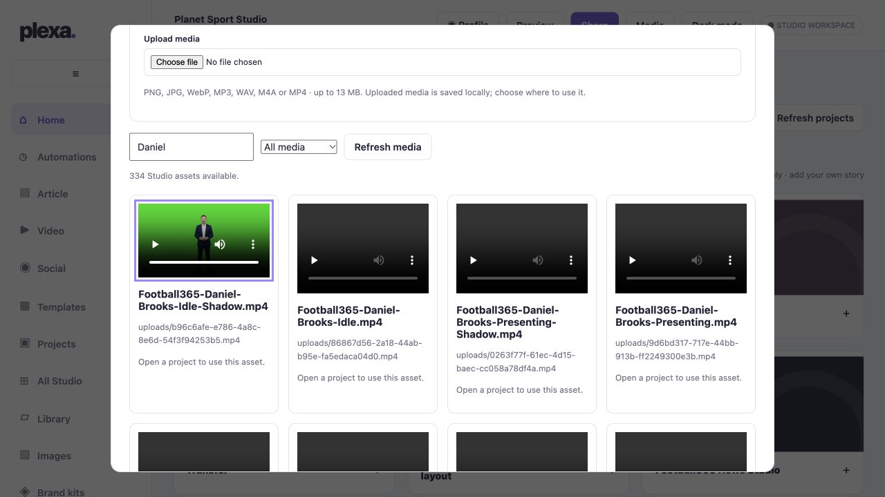

# Daniel Brooks presenter integration

## Hosted assets verified 31 October 2026

All 12 supplied MP4 files from `f365-male-presenter-videos` were uploaded to the authenticated hosted Studio Media Library. A full page reload retained all 12 entries. The Idle Shadow upload played to its 12-second end without a media error.

Names use `Football365-Daniel-Brooks-` followed by Idle, Presenting, Point-Right, Point-Left, Walking or Listening, with a separate `-Shadow` variant for each. Original bytes were preserved. Each is below 4 MB; no compression was necessary. All are 1920x1080, 30fps H.264 yuv420p with no alpha channel. The preview has a green background: transparent exports or chroma key processing are still required before compositing. No lip-sync or voice generation was performed.

## Development implementation

Admin > Presenters & Profiles and Users & Permissions link to a directory with Real users, Presenters and Agents. Individual pages edit biography, linked assets and a connected ElevenLabs voice, with permission confirmation and revision protection. Authorization is checked server-side against current user state. Profile edits cannot grant login roles or agent execution rights. Agent profiles link their existing animation assets; presenter characters have no login or server access.

Daniel is explicitly fictional. His default voice is the existing account voice `Planet F1 - Male - Sam`, verified in the live catalogue as `2yqdQ7uuPQDBMgFA8dgu`. No other voice named Sam is substituted. His 12 clips are discovered from the hosted Library names. Maya is a pending profile with no assigned voice or invented biography. Real user voices remain selectable, not automatically assigned.

Profile edits persist in the existing hosted workspace with an audit entry and conditional writes. The directory defaults are not a saved live production assignment until the new code is deployed and the profile saved. This change does not wire profile selection into video narration; existing production voice controls remain in place.

## Verification and remaining release work

TypeScript, lint, unit/API tests and production build were run. Tests cover admin-only reads/writes, cross-origin rejection, rejected role changes, unknown media/voice rejection, persistence preserving existing projects, and stale update conflicts.

Hosted media upload and representative playback verified. New authenticated profile-page visual checks, actual profile save/reload in a review deployment, and narration selection integration remain pending. The repository release gate also calls for Dev Gateway OpenAI Release QA review and Bazza approval before main. No production code deployment was performed for this profile implementation.
