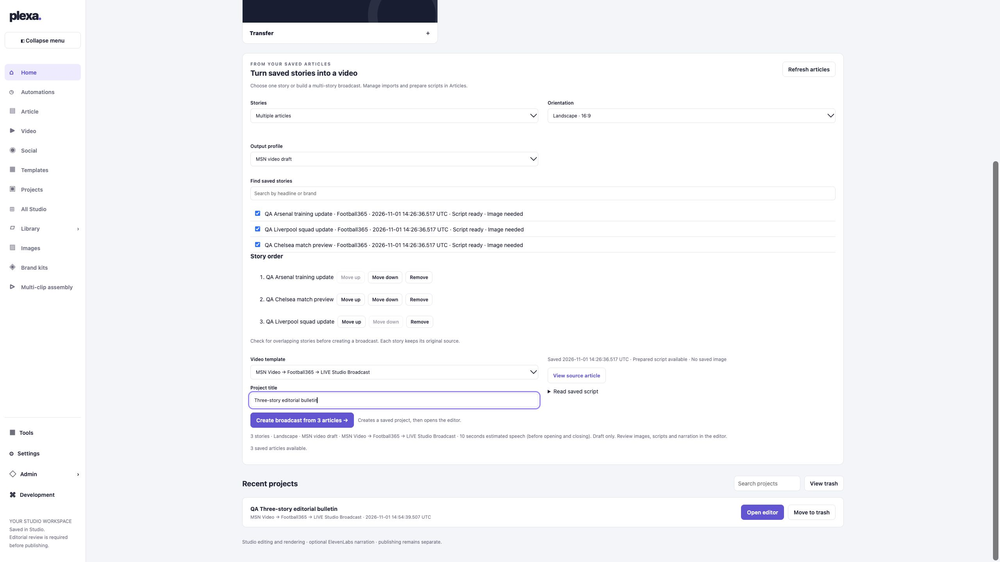
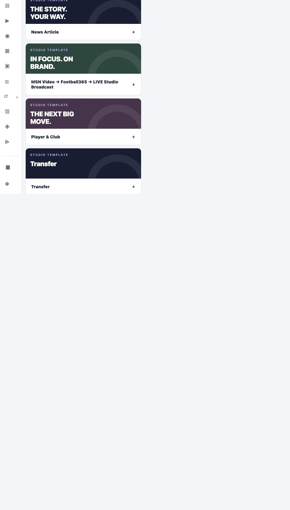
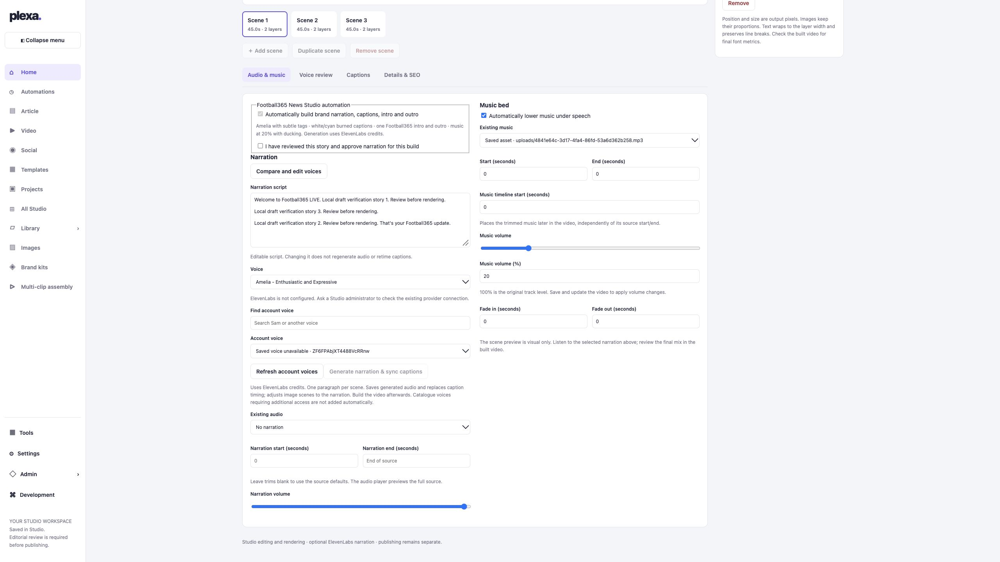

# Saved article builder — development review

Branch: codex/article-builder. No production deployment or paid generation performed.

The hosted Studio builder now offers single and multiple article selection, search by headline/brand, ordered selection with remove/up/down controls, template capability filtering, server-side compatibility checks, script freshness and image readiness, a speech-duration estimate, and a draft review summary. It opens the existing editor and broadcast rundown. Custom titles are retained without renaming previously linked projects. The saved article picker reads through Language Studio Imports without rewriting articles or mutating them during GET.

## Verified

- 158 Studio node tests passed, including real local MP4 rendering, broadcast source preservation, ordering and saved-project reopening.
- Release gate: TypeScript, lint, 298 unit/API tests passed (one pre-existing skipped test), production build passed.
- Authenticated local browser: selected three fixture stories, chose compatible MSN template, reordered stories, created a draft, returned home and reopened it. Title and Arsenal / Chelsea / Liverpool order persisted.
- Fixture project: d965bd3b-239d-4ee6-8709-97a851d50766. Test data only; no real news publication.
- Browser layout inspected at desktop, 780px and 480px actual CSS widths. No document overflow; at 480px collapsed navigation leaves a 342px form. Browser viewport backend did not reach 390px; that width is not claimed verified.
- Creating a draft queued no provider/render/publication jobs.

Initial node render tests failed because the fresh checkout lacked output/msn-local. Creating the test output directory resolved all three failures. Initial browser POST failed with the existing IPv6 development binding's origin mismatch. Binding the local development server explicitly to localhost resolved it; production origin checks were not weakened.

## Supported combinations and remaining work

- Single: existing landscape news/player/transfer layouts; compatible saved landscape layouts.
- Multiple: the existing Football365 LIVE Studio Broadcast, 2–50 distinct Football365 stories with current prepared scripts and the approved background.
- MSN selection describes a draft template, not certification or publication.
- Portrait and Short are visible but disabled: this implementation does not add or verify new format-specific layouts.
- Saved custom broadcast layouts remain unavailable in this picker until their background/screen mappings can be retained safely by the broadcast creation adapter.
- Other-brand multi-story templates are not invented or relabelled as Football365.
- Story overlap has an editorial review prompt; automated semantic overlap detection is not implemented.
- Paid narration and full production broadcast delivery were not tested. Existing approval/render controls remain intact.
- Legacy standalone editor retains single-story creation; multi-story creation is enabled only in the hosted workspace where the broadcast API exists.
- Production review and deployment approval remain outstanding.

## Screenshots

